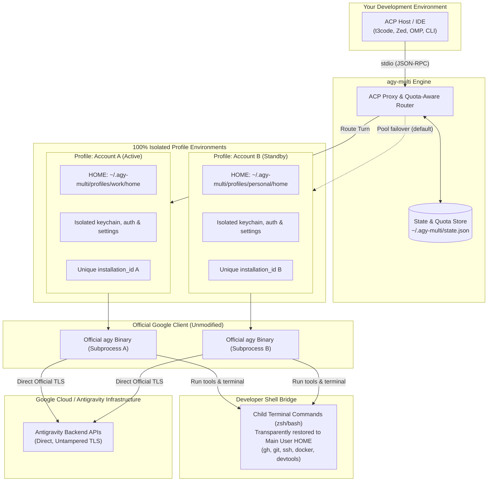

# agy-multi

> [!IMPORTANT]
> **Disclaimer**: `agy-multi` is an **unofficial**, community-driven open-source project. It is **not** developed, affiliated with, maintained, or endorsed by Google. "Antigravity", "Gemini", and "Google" are trademarks of Google LLC.

> [!NOTE]
> **Requires an ACP Client / Host**:
> `agy-multi` is an **ACP (Agent Client Protocol) Proxy Server**, not an interactive terminal chat replacement or patch for `agy`. It is designed to be connected to an **ACP Client / AI Editor** (such as **T3 Code**, **Zed**, or any interactive ACP client). It runs in **account-pool mode** by default (automatic quota failover and parallel multi-account routing); pass `--sequential` to keep only one account active at a time.

Run the official Antigravity CLI (`agy`) across isolated Google accounts — without patching the binary, proxying
traffic, or reimplementing the protocol.

## System overview

The Bun entry points run either a one-shot `agy` command or a stdio ACP proxy.
The proxy routes JSON-RPC between the host and `agy acp` child processes; the
children, not the proxy, connect to Antigravity.

## Subdirectories & system boundaries

- [Source engine](./src/README.md) — CLI dispatch, profile provisioning, quota
  and model snapshots, one-shot routing, and updates. Its
  [ACP component](./src/acp/README.md) owns protocol routing and session state.
- [Checkout launchers](./bin/README.md) — POSIX and Windows shims that pass
  arguments to the source entry points under Bun.

## Local interface & invariants

- [`package.json`](./package.json) maps `agy-multi` and `agy-multi-acp` to
  separate TypeScript entry points; `bun run build` compiles both.
- [`install.sh`](./install.sh) (`install_from_prebuilt`) and
  [`install.ps1`](./install.ps1) (`Install-FromPrebuilt`) require both executable
  files in a prebuilt archive. A local checkout or `AGY_MULTI_FROM_SOURCE=1`
  selects the source build. The in-app updater separately checks the archive
  SHA-256 and the staged main executable's version before replacement
  ([`installLatestRelease`](./src/update.ts)).

## Global invariants

- A child uses its profile's HOME; managed profiles may share conversation
  files, but adopted HOMEs skip managed provisioning
  ([`profileEnvOf`](./src/registry.ts), [`syncProfiles`](./src/profile.ts)).
- A handoff leaves the client-facing session ID intact. The proxy does not
  retry a failed turn on another profile after forwarding model output
  ([`runPrompt`](./src/acp/server.ts)).

## Global side effects

- Profile metadata, quota blocks, and ACP session records are separate stores
  under the wrapper root ([`profileMetaPath`](./src/paths.ts),
  [`AccountPool`](./src/account-pool.ts), [`SessionLedger`](./src/acp/session-ledger.ts)).
- The installers can download a release or build from a checkout, write to the
  install directory, and add ACP rules to `~/.gemini/GEMINI.md`
  ([`install.sh`](./install.sh), [`install.ps1`](./install.ps1)).

## System verification

From the repository root, run `bun test`, `bun run typecheck`, and `bun run build`.

## Why an isolated HOME

`agy` keeps auth, conversations, settings and `installation_id` under
`~/.gemini`. A different `HOME` is a genuinely separate installation:

- Fresh HOME → agy creates its own `~/.gemini`, its own keychain/file token and
  its own auth state.
- A profile-level keychain is created inside that HOME. The wrapper does not
  change the desktop session's default keychain.
- `GEMINI_DIR` is **not** sufficient: it does not isolate auth.

Conversations are the deliberate exception. `brain/`, `conversations/` and
`history.jsonl` are linked into one store under `~/.agy-multi/shared/gemini`, so
switching accounts keeps the thread — the same thing that happens when you
re-login inside `agy` itself. Credentials, accounts, settings, caches and logs
stay inside each profile HOME. `conversation_summaries.db` stays per account on
purpose: it is an index that cannot be merged safely, and each account listing
its own conversations is harmless. Existing profile carry-overs are moved into
the shared store on the next `agy-multi sync` or ACP start; if two accounts hold
the same conversation id, the losing copy is kept in
`~/.agy-multi/shared/gemini/migrated` rather than deleted. Profiles that adopt an
existing HOME (`profile add --home`) are left exactly as they are.

The wrapper only chooses which HOME runs, at turn boundaries. On the wire it is
100% the official client.

## Architecture & How It Works



## Compliance: what is and is not permitted

This project does not claim that any configuration avoids a ban. Here is what
Google actually publishes, and how the tool maps to it.

- **Antigravity Additional Terms §6** — "using the Service in connection with
  products not provided by us… Using third party software, tools, or services to
  access the Service (e.g. using OpenClaw with Antigravity OAuth) is a breach of
  this Agreement", with suspension of the Antigravity and/or Gemini CLI accounts
  as the stated consequence — <https://antigravity.google/terms/>
- **FAQ** — "Wrapping `agy` inside third-party coding agents or applications, or
  automating account rotation, is not supported under consumer plans" —
  <https://antigravity.google/docs/faq>
- **Maintainer answer on ACP** — an interactive ACP client driven by a human is
  fine, including a custom non-editor UI; using `agy acp` as a backend for
  another agent, an autonomous harness or a background orchestrator is not —
  <https://github.com/google-antigravity/antigravity-cli/issues/1493>

What that means for this tool:

| Mode | Where it stands |
|---|---|
| Pooled failover between accounts (default, or `--sequential`) | Automatic account rotation — explicitly not supported on consumer plans |
| `gemini-api-key` / `agent-platform` auth via `agy` itself | The path Google recommends for automation and higher concurrency |

`agy-multi` still launches the unmodified official binary, never decrypts
traffic, and never spoofs a User-Agent, but none of that changes the two bullets
above. Compliance is about what the tool does, not how carefully it hides it.

Still true, and still worth keeping:

1. **Zero Binary Patching** — the official binary runs as an external subprocess.
2. **Zero Traffic Decryption** — TLS goes from `agy` to Google; no proxy, no
   self-signed certificate, no packet modification.
3. **Single-Writer Turns** — a turn whose output already streamed is never
   replayed elsewhere.

4. **Quota Protection & Anti-Spam Backoff**:
   - When a prompt hits `RESOURCE_EXHAUSTED` (429), `agy-multi` can block that profile and model family until the reported reset or a default backoff. ACP can retry on another eligible profile only before output is forwarded.
   - It does not hammer exhausted endpoints or retry failed calls repeatedly, ensuring standard respectful API behavior.

5. **Transparent Developer Shell Bridge**:
   - The isolated `HOME` is confined to `agy`'s internal auth. Child commands spawned by the agent (`gh`, `git`, `ssh`, `docker`) automatically map to your primary user's environment, avoiding missing SSH keys or broken developer tool credentials.

## Account pool (default) and sequential mode

> [!WARNING]
> Automatic rotation is **not permitted** on consumer Antigravity plans: the FAQ says
> wrapping `agy` inside third-party coding agents and automating account rotation
> are unsupported, and Terms §6 makes third-party access a breach. Running
> `agy-multi` is at your own account risk.

`--switch-delay <seconds>` (default 10 in pool mode, `0` disables) pauses before a
turn is handed to another account. It is **pacing**, so a fresh account is not hit
the instant the previous one returns 429. It is not a detection countermeasure:
the switch's timing is not what identifies a harness, and this does not make
rotation permitted or invisible.

Both ACP modes rank profiles from cached `/usage` and model snapshots.
In `--sequential` mode, the proxy stops the previous `agy acp` child and waits
up to five seconds for it to exit before starting the next one.

Concurrent sessions on that one account are normal and run in parallel: several
sessions, different models, one process. Only crossing to another account is
serialized. Model reservation is therefore a pool-only rule — it is worth
keeping a wider catalog for its own models only when a switch is cheap, and here
every switch costs a teardown plus a resume or handoff — so the live account
serves any model it supports.

Because only one agent process may be alive, sequential mode cannot serve two
concurrent sessions on different accounts. If a switch would have to kill an
in-flight turn, the request is refused with `sequential mode: account <slug> is
mid-turn` instead — the running turn finishes intact, and the client retries
afterwards. Choose pool mode if you need parallel sessions across accounts.

A session is pinned to the account it was created on and only re-ranks when that
account becomes unusable (banned, signed out, quota-blocked, or the model is not
offered there). So a subagent that opens `session/new` while another account is
mid-turn is placed on that busy account — same process, second session — even
when its own quota is below the reserve, because the only alternative would be a
refused switch. A subagent asking for a model the busy account supports runs
alongside the parent turn; a model only another account offers has to wait for
that turn to end. Two sessions on two accounts still work over time: the idle
child is replaced, and the parked session is resumed, or handed off as a fresh
conversation when the agent lost it.

When an active account runs out of quota, pooled mode keeps the client session ID and continues the same conversation on the next available account. Because the conversation store is shared, the new account resumes that conversation by id (`session/resume`) and receives only the user's current message — no replay, no rewritten prompt. When the conversation cannot be resumed (it is not in the store, or the agent refuses it), the proxy falls back to replaying the client's transcript verbatim as `User:` / `Assistant:` turns: no framing line, no request to continue, no account narrative, no synthesized tool markers, in full by default (`--handoff-context <chars>` caps it). Tool calls cannot cross either way: ACP carries text, so only text survives a replay.

The replay carries no tool state: tool calls themselves are not replayed, so the new account has no in-memory call history and must re-verify the workspace.

```mermaid
sequenceDiagram
    autonumber
    actor Dev as Developer / IDE (t3code)
    participant Proxy as agy-multi Proxy
    participant ActA as Account A (Active)
    participant ActB as Account B (Standby)
    participant Google as Google Antigravity API

    Dev->>Proxy: session/prompt ("Refactor database layer")
    Proxy->>ActA: Forward prompt via agy acp
    ActA->>Google: Direct TLS request (Account A token)
    Google-->>ActA: 429 RESOURCE_EXHAUSTED (Quota limit)
    Note over Proxy,ActA: Quota 429 received BEFORE any output streams
    Proxy->>Proxy: Quota-block Account A in state.json until reset
    Proxy->>Proxy: Rank Account B from cached /usage + model snapshots
    Proxy->>ActB: session/resume (shared conversation store)
    alt conversation cannot be resumed
        Proxy->>ActB: session/new + text-only transcript replay
    end
    ActB->>Google: Direct TLS request (Account B token)
    Google-->>ActB: 200 OK (Streaming generation)
    ActB-->>Proxy: Stream assistant output & tool calls
    Proxy-->>Dev: Seamless response (same proxy session ID; streamed once)
```

## Installation

### Option 1: One-line Install (Recommended)

**macOS & Linux:**
```bash
curl -fsSL https://raw.githubusercontent.com/iqbal-codes/agy-multi/main/install.sh | bash
```

**Windows (PowerShell):**
```powershell
irm https://raw.githubusercontent.com/iqbal-codes/agy-multi/main/install.ps1 | iex
```

*The installer installs the prebuilt `agy-multi` and `agy-multi-acp` binaries for your platform (macOS/Linux x64 or arm64; Windows x64) into `~/.local/bin` (`PATH`). It installs Bun and compiles from source only when run inside a checkout, with `AGY_MULTI_FROM_SOURCE=1`, or when no prebuilt release is available.*

### Option 2: Bun Global Install (`bun install -g`)

```bash
# Direct from GitHub:
bun install -g github:iqbal-codes/agy-multi

# Or from local clone:
git clone https://github.com/iqbal-codes/agy-multi.git
cd agy-multi
bun install -g .
```

### Option 3: Local clone & installer

```bash
git clone https://github.com/iqbal-codes/agy-multi.git
cd agy-multi
bun install
./install.sh       # compiles standalone binaries to ~/.local/bin
```

### Updating

```bash
agy-multi update           # install the latest GitHub release
agy-multi update --check   # only report what is available
agy-multi --version        # the version this binary reports
```

`update` reads the latest release, picks the archive for your platform
(`agy-multi-darwin-arm64.tar.gz`, `agy-multi-linux-x64.tar.gz`, …), verifies its
SHA-256 against the release digest (or `SHA256SUMS.txt`), and only then replaces
`agy-multi` and `agy-multi-acp` in place. The downloaded binary's `--version`
must match the release before anything is swapped, so a corrupt or mismatched
archive leaves the installed copy untouched. Running ACP sessions keep the
previous binary until they restart; profile state under `~/.agy-multi` is never
modified. `--force` reinstalls the current version.

Bun-global or source installs have no installed binary to replace: `update` says
so instead of guessing — rebuild a checkout with `./install.sh`, or re-run
`bun install -g`. For forks and mirrors, point it elsewhere with
`AGY_MULTI_REPO_SLUG` (and `AGY_MULTI_GITHUB_API` for GitHub Enterprise).

## Commands

```bash
# New isolated account (interactive Google login + generation canary).
# The first quota snapshot is recorded right after the login check.
agy-multi profile add work

# Omit the name to auto-generate account-1, account-2, ... instead.
agy-multi profile add

# Re-authenticate or login to an existing profile (also records a snapshot)
agy-multi profile login work

# Temporarily disable / enable a profile from rotation
agy-multi profile disable work
agy-multi profile enable work

# Remote / SSH login (prints OAuth URL in terminal to copy-paste):
agy-multi profile add work --remote
agy-multi profile login work --remote

# Adopt the existing main installation (no login, no canary).
agy-multi profile add main --home "$HOME" --no-login

# Resync shared configuration and re-probe quota across all profiles in parallel.
# Quota is always re-probed; --force also refreshes model catalogs.
agy-multi profile sync

# Resync one profile and force-refresh its model catalog too.
agy-multi profile sync work --force

agy-multi profile list
agy-multi profile remove work

# Print cached quota snapshots, or refresh all accounts in parallel.
# ACP automatically warms stale caches in the background on startup in pool mode.
agy-multi quota [--profile <slug>] [--refresh]
agy-multi multi-usage [--profile <slug>] [--refresh]

# Check token usage & Gemini 3.8 Flash cost analytics
agy-multi usage [--daily | --weekly | --monthly] [--profile <slug>] [--json]

# Start ACP proxy server (account-pool by default)
agy-multi acp [--clean] [-- agy acp args...]

# Start ACP proxy in sequential pool mode (one active account at a time)
agy-multi acp --sequential

# Run a non-interactive prompt (account-pool by default)
agy-multi run --prompt "fix the failing test" --model gemini-3.8-flash [--profile <slug>]

# Run in clean subagent mode with manual injections (ala Pi Agent)
agy-multi run --prompt "review this diff" --clean --skills "git,diagnosing-bugs" \
              --system-prompt "You are a code reviewer"

agy-multi run --conversation <id> --prompt "continue"
agy-multi state

# Update the installed binaries to the latest GitHub release
agy-multi update [--check] [--force]
```

### Token Usage & Cost Analytics (`usage`)

`agy-multi quota` prints the cached remaining-quota percentages that the proxy already synced from the CLI's `/usage` command; it never starts a check of its own, so it answers in milliseconds. `--refresh` probes all healthy accounts in parallel. `agy-multi usage` (or `agy-multi tokens`) is a different report: it aggregates exact token metrics and computes estimated cost across all profile transcript logs (`transcript.jsonl`).

Rates are calculated based on **Gemini 3.8 Flash** pricing:
- **Input Tokens**: `$1.50` / 1M tokens
- **Output Tokens**: `$7.50` / 1M tokens
- **Cache Read Tokens**: `$0.15` / 1M tokens

```bash
# Full dashboard table (Today, This Week, This Month, All Time + By Profile)
agy-multi usage

# Filter by time period
agy-multi usage --daily
agy-multi usage --weekly
agy-multi usage --monthly

# Filter by profile
agy-multi usage --profile account-2

# Machine-readable JSON output (ideal for dashboards or agent tooling)
agy-multi usage --daily --json
```

**Sample Output:**
```
=== Gemini 3.8 Flash Token Usage & Cost Analytics ===
Rates: Input: $1.5/M | Output: $7.5/M | Cache Read: $0.15/M

Period         Input Tokens  Output Tokens      Cache Read    Total Tokens   Est. Value   Turns
-----------------------------------------------------------------------------------------------
Today             3,619,652        268,056      72,360,580      76,248,288       $18.29     508
This Week        14,177,801      1,078,742     292,567,912     307,824,455       $73.24   2,592
This Month       14,177,801      1,078,742     292,567,912     307,824,455       $73.24   2,592
All Time         16,514,743      1,160,330     320,259,304     337,934,377       $81.51   2,878

--- By Profile Breakdown (All Time) ---
Profile          Input Tokens  Output Tokens      Cache Read    Total Tokens   Est. Value   Turns
-------------------------------------------------------------------------------------------------
main               10,845,836        759,895     222,852,580     234,458,311       $55.40   1,983
account-2           1,245,581         79,414      13,478,655      14,803,650        $4.49     239
account-4           4,334,199        321,000      83,928,069      88,583,268       $21.50     651
```

### Subagent Clean Mode & Manual Injections (ala Pi Agent)

When using `agy-multi` as a subagent worker for orchestrators (like Claude Code, Codex, or T3 Code), background skills, MCP tools, and default instructions can cause severe **context bloat** and slow down execution.

`agy-multi` adopts the clean injection pattern popularized by **Pi Agent (`omp`)**:

| Flag | Purpose |
|---|---|
| `--clean` / `--no-skills` | Bypasses all default skills, plugins, rules bloat, and disables slash commands. |
| `--skills <list>` | Whitelists only specific skills (e.g. `git,chrome-devtools` or path to custom skill folder). |
| `--system-prompt <text\|file>` | Replaces base system instructions with custom text or instructions from a file. |
| `--append-system-prompt <file>` | Appends additional instructions to the prompt. |

#### In CLI Mode (`run`):
```bash
agy-multi run --prompt "Verify the fix for issue #42" \
              --clean \
              --skills "git,diagnosing-bugs" \
              --system-prompt "./prompts/code-reviewer.txt"
```

#### In ACP Server Mode (`acp`):
Pass `--clean` when configuring the ACP command in your orchestrator or IDE:
```bash
agy-multi acp --clean
```
This automatically instructs `agy acp` to launch with `--include-default-customizations=false --disable-slash-commands`.

### Remote / Headless / SSH Login

When running `agy-multi profile add [<slug>]` on a remote machine, VPS, or over SSH:
1. `agy` automatically prints the Google OAuth URL directly in the terminal:
   ```
   Open this link in a browser to log in with Google:
     https://accounts.google.com/o/oauth2/auth?...

   Then paste the authorization code, or the full URL of the page you land on, and press Enter:
   ```
2. Copy the URL and open it in any browser on your local laptop or phone.
3. Sign in to your Google account and grant consent.
4. When Google redirects to `https://antigravity.google/oauth-callback?code=...&state=...`, copy the full URL from the browser address bar (or just the `code`).
5. Paste it back into the remote terminal and press Enter. The account is now authenticated and ready!


`acp` ranks candidates from cached `/usage` and model snapshots. One-shot `run`
refreshes stale snapshots in parallel before ranking. Both keep track of the
conversation's account and can fail over on quota, ban, or auth errors.

## Pool failover rules

| Signal | Action |
|---|---|
| `SUCCESS` | `run` pins the conversation and writes a checkpoint; both ACP and `run` record `lastGenerationOkAt` |
| quota / `RESOURCE_EXHAUSTED` | block that profile+family until the reset, try the next |
| `403` + "violation of Terms of Service" | mark profile **banned**, never select it again |
| not logged in / auth error | mark profile `auth-required`, try the next |
| network / transient | return the error; switching accounts cannot fix it |

`run` failover is **checkpoint-only**: a conversation is never resumed under a
different account. The next account starts a fresh conversation seeded with the
previous turn's checkpoint (original prompt, last result, cwd, git HEAD).
Cross-profile ACP handoff keeps the conversation instead: it prefers
`session/resume` on the shared store and falls back to a text-only `session/new`
seeded from the client transcript. A turn whose output already streamed is never
replayed.

## Multi-platform Support

`agy-multi` works natively across **macOS**, **Linux**, and **Windows**:

| Platform | Auth & Isolation Details | Symlinks / Linking |
|---|---|---|
| **macOS** | Creates `agy-multi.keychain-db` per profile via `/usr/bin/security`, exposed at `login.keychain-db` through a symlink for the official CLI. Unlocks noninteractively before changing settings; setup failures stop startup with an error. Existing profile databases are moved intact on sync. | Standard POSIX symlinks. |
| **Linux** | Uses Secret Service / file-based token fallback (`~/.gemini/antigravity-cli/antigravity-oauth-token`). macOS keychain calls are automatically bypassed. | Standard POSIX symlinks. |
| **Windows** | Automatically sets `%USERPROFILE%`, `%HOMEPATH%`, and `%HOMEDRIVE%` alongside `$HOME`. Go's `os.UserHomeDir()` resolves `%USERPROFILE%` first, ensuring complete account isolation for `agy.exe`. | Directory junctions (`junction`) and hardlink/copy fallbacks are used so non-admin users without Developer Mode never hit `EPERM` symlink errors. |

### Windows Launchers
For Windows CMD and PowerShell:
```cmd
bin\agy-multi.cmd profile list
bin\agy-multi.cmd acp
```
Or via dedicated ACP binary:
```cmd
bin\agy-multi-acp.cmd
```

## ACP host (t3code, Zed, OMP, any ACP client)

`agy-multi models` and the ACP catalog list the versioned Gemini models that
Antigravity advertises for your accounts. This includes new Gemini releases
as they become available to the account pool.

`agy-multi acp` is a stdio ACP server. An ACP host sees **one** Antigravity
provider backed by your account pool (rotating automatically on
quota/ban/auth); pass `--sequential` to keep only one account active at a time.

In t3code: **Settings → Providers → Add provider → Local ACP command**.

| Field | Value |
|---|---|
| Executable | `agy-multi` (or absolute path: `~/.local/bin/agy-multi`) |
| Arguments | `acp` (pool default) or `acp --sequential` |
| Environment | none — installed standalone binary handles execution |

`install.sh` / `install.ps1` install the prebuilt single-binary executables into `~/.local/bin/` (`$HOME/.local/bin/agy-multi` and `agy-multi-acp`) by default; they compile from source only for a local checkout, with `AGY_MULTI_FROM_SOURCE=1`, or when no prebuilt release is available.

`agy-multi acp -- --dangerously-skip-permissions` forwards extra args to the
`agy acp` child it runs.

After login and on every `agy-multi profile sync`, `agy-multi` re-probes quota
(and reasoning) across all healthy accounts in parallel; model catalogs refresh
when stale or with `--force`. ACP also warms stale caches in the background on
startup in pool mode. Session responses (`session/new`, `session/load`,
`session/resume`, `session/fork`) merge this cached catalog across healthy
accounts automatically.

For **OMP (Oh My Pi)** or harnesses expecting a dedicated ACP executable:
```bash
export AGY_ACP_BIN="$HOME/.local/bin/agy-multi-acp"
```
Or use `~/.local/bin/agy-multi-acp` (or `agy-multi-acp.exe` on Windows) directly.

What the proxy does:

- `initialize` selects a healthy control profile — not banned, auth-required, or
  disabled; unblocked, `main`, and recently successful accounts first — without
  probing `/usage`, and retries the next candidate if the handshake fails.
- `session/new` picks the highest-ranked profile from the cached `/usage` and
  model snapshots and pins the session to it.
- `session/prompt` runs on the pinned profile. If that profile is blocked,
  banned, auth-required, or under the 10% reserve, the proxy re-ranks from the
  cached snapshots and hands the conversation to the next profile: it prefers
  `session/resume` by conversation id on the shared store and falls back to a
  fresh `session/new` with a text-only transcript replay. The client keeps the
  same proxy session id.
- If the agent fails with quota / ban / auth **before any output**, the handoff
  happens inside the running turn: the client receives the result from the new
  account.
- If output was already streamed, the turn returns the error. Handoff is
  deferred until the next prompt rather than retrying the failed turn.
- Bans and auth requirements are stored in the profile's metadata
  (`profile.json`); quota blocks live in `state.json`. All are excluded from
  selection, and a 403 ToS ban is never retried.
- An account with a wider model catalog is reserved for its own models: a
  baseline request goes to the account that only offers baseline models, so the
  premium catalog is not spent on work a smaller account can do. The reservation
  only holds while that smaller account can actually take the request — if it is
  banned, signed out, quota-blocked, or under the reserve, the wider catalog
  serves the baseline model instead of failing the request.
- `session/load` and `session/resume` after a proxy restart use the persisted
  profile, child session ID, model, user/assistant history, and handoff state in
  `acp-sessions.json`. Load replays messages; resume does not duplicate them.
  Older mapping-only records hydrate history through a silent load on resume.
- If an agent process exits, the next prompt resumes its existing conversation.
  If the conversation is unavailable, a replacement receives a contextual handoff.
- On macOS/Linux, each account's ACP agent runs in an isolated process group.
  Proxy shutdown or agent exit terminates its remaining MCP/tool descendants.
  Closing/deleting the last session, or switching away from an account's last
  session, releases that account's agent after in-flight client requests finish.
  Shared agents remain alive while other sessions use them. Closed conversations
  retain their persisted history and can be resumed with a new agent process.
  Idle but open sessions stay running; this does not impose an inactivity timeout.
- Native `usage_update` events are forwarded immediately during an active prompt,
  unchanged apart from the session ID; they are not buffered until the turn ends.
  When the agent publishes none, the proxy derives a `usage_update` from the
  latest token-bearing transcript row, when one exists, with a context `size`
  resolved from the model id. It does not invent a dollar cost. An AGY
  checkpoint may reduce active context without changing the conversation ID.
- `session/list` lists sessions created through the proxy. Sessions created
  directly by the `agy` CLI are not merged into that list.
- `authenticate` runs on the current control profile (the healthy profile chosen
  for `initialize`). Re-authenticate a specific account with `agy-multi profile
  add <slug>` (or `agy acp --login` in its HOME); the proxy is intentionally one
  provider instance, not one per account.

Limitations: the fallback `session/new` replay carries user/assistant text — the
whole transcript by default, or the newest turns under
`--handoff-context <chars>` — not complete tool results or in-memory tool state.
Handoff requires the selected model; if the target rejects `session/set_model`,
the turn fails rather than silently generating with another model. Completed and
protocol-error turns are persisted, but a hard process kill can still interrupt
a streamed response before its full text is saved.

## Layout

```
~/.agy-multi/
├── state.json                    # pins, quota blocks, checkpoints
├── acp-sessions.json             # session mapping, model, text history, handoff state
├── shared/gemini/                # one conversation store for every account
│   └── antigravity-cli/{brain,conversations,history.jsonl}
└── profiles/<slug>/
    ├── profile.json              # email, status, timestamps
    ├── acp-<pid>.log             # ACP process log (debugging)
    └── home/                     # HOME for this account
        ├── .gemini/              # per-account auth; conversations link to shared/
        ├── Library/Keychains/    # isolated keychain
        └── .gitconfig, .config, .ssh, ...  # symlinks to the real home
```

Shared (symlinked): `.gemini/config`, `.gemini/skills`, `GEMINI.md`,
`antigravity-cli/settings.json`, and tool config (`.gitconfig`, `.config`,
`.ssh`, `.npmrc`, `.netrc`, `.agents`, `.aws`, `.kube`, `.docker`).
Across profiles: conversations — `brain/`, `conversations/` and `history.jsonl`
point at `shared/gemini`.
Per-profile: auth token/keychain, accounts, settings, caches, logs,
`installation_id`, and the conversation index (`conversation_summaries.db`).

## Safety notes

- The official `agy` binary and its OAuth client are never modified.
- One account per running process; conversations are single-writer.
- A banned account still reports 100% on `/usage`; only a generation canary or a
  real turn detects it. `profile add` runs a canary by default.
- Automatic multi-account rotation is not permitted under the Antigravity Terms;
  using `agy-multi` is at your own account risk.

## Tests

```bash
bun test
bun run typecheck
```

`test/acp-proxy.test.ts` drives the real proxy against a fake `agy` process. It
covers both pool modes: in the default pool mode, `acct-a` is blocked on
`RESOURCE_EXHAUSTED` and the turn completes on `acct-b`; with `--sequential`,
only one account child runs at a time and idle accounts are never probed.
