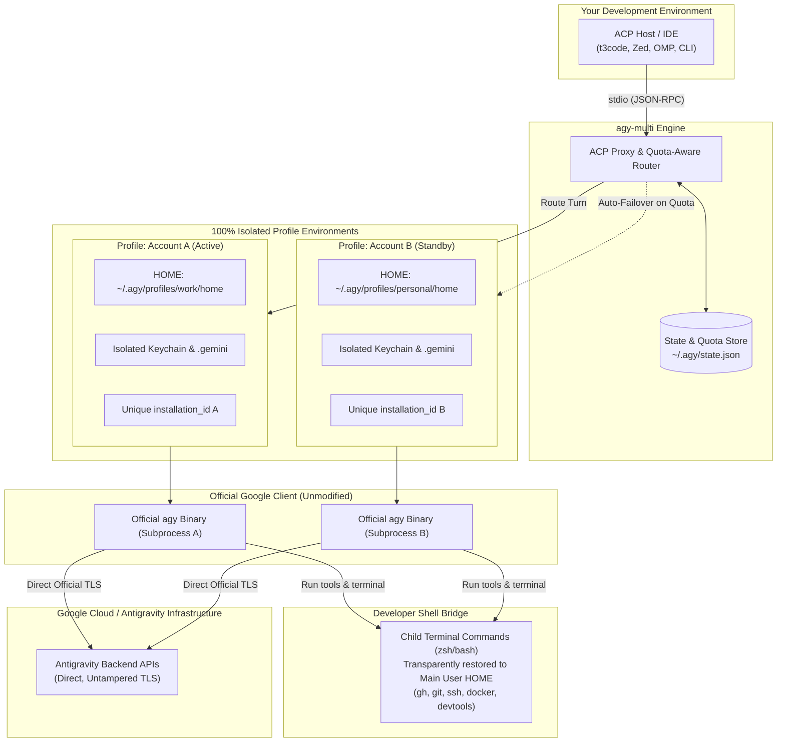
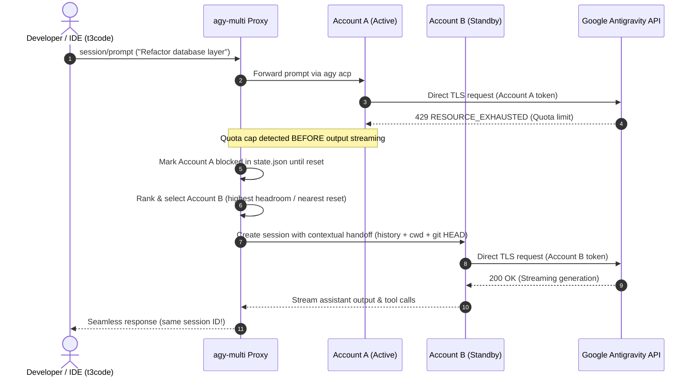

# agy-multi

> [!IMPORTANT]
> **Disclaimer**: `agy-multi` is an **unofficial**, community-driven open-source project. It is **not** developed, affiliated with, maintained, or endorsed by Google. "Antigravity", "Gemini", and "Google" are trademarks of Google LLC.

> [!NOTE]
> **Requires an ACP Client / Host**:
> `agy-multi` is an **ACP (Agent Client Protocol) Proxy Server**, not an interactive terminal chat replacement or patch for `agy`. It is designed to be connected to an **ACP Client / AI Editor** (such as **T3 Code**, **Zed**, **Oh My Pi (OMP)**, or custom ACP harnesses). The ACP client sees a single agent, while `agy-multi` manages multiple Google accounts and seamless quota failover in the background.

Run the official Antigravity CLI (`agy`) with multiple Google accounts and
automatic, quota-aware failover — without patching the binary, proxying traffic,
or reimplementing the protocol.

## Why an isolated HOME

`agy` keeps auth, conversations, settings and `installation_id` under
`~/.gemini`. A different `HOME` is a genuinely separate installation:

- Fresh HOME → agy creates its own `~/.gemini`, its own keychain/file token and
  its own conversation store.
- A profile-level keychain is created inside that HOME. The wrapper does not
  change the desktop session's default keychain.
- `GEMINI_DIR` is **not** sufficient: it does not isolate auth.

The wrapper only chooses which HOME runs, at turn boundaries. On the wire it is
100% the official client.

## Architecture & How It Works



## How `agy-multi` Stays Safe & Avoids Google ToS Bans

Multi-account tooling often risks account suspension when implemented carelessly (e.g. via proxy hacks, header tampering, or session replay). `agy-multi` is architected specifically to eliminate these risks:

1. **Zero Binary Patching (100% Official Binary)**:
   - `agy-multi` never disassembles, patches, bytecode-edits, or hooks into the Google Antigravity binary.
   - It runs the official binary directly as an external subprocess, preserving Google's authentic binary signatures, checksums, and runtime integrity.

2. **Zero Traffic Decryption / No MITM Proxy**:
   - `agy-multi` **never** decrypts or intercepts network traffic between `agy` and Google.
   - TLS connections originate directly from the official `agy` client and terminate at Google servers using standard system TLS certificates. No self-signed certificates, proxies, or packet modifications exist.

3. **Isolated Identity & Pristine Fingerprints**:
   - Anti-abuse systems flag accounts when multiple identities share conflicting cookies, shared SQLite stores, or identical persistent installation keys.
   - By creating a separate `HOME` directory per profile, each account receives its own isolated `~/.gemini/` storage, private macOS Keychain, and independent `installation_id`. Google sees each profile as a genuine, cleanly separated installation.

4. **Legitimate Single-Writer Turn Boundaries**:
   - Conversations are strictly single-writer. `agy-multi` never runs multiple accounts against the same conversation simultaneously.
   - A turn is **never replayed** once output has been streamed to the user, preventing anomalous duplicate requests or state desynchronization.

5. **Quota Protection & Anti-Spam Backoff**:
   - When an account hits `RESOURCE_EXHAUSTED` (429) or drops below the 10% reserve threshold, `agy-multi` marks it blocked and honors the reset duration.
   - It does not hammer exhausted endpoints or retry failed calls repeatedly, ensuring standard respectful API behavior.

6. **Transparent Developer Shell Bridge**:
   - The isolated `HOME` is confined to `agy`'s internal auth. Child commands spawned by the agent (`gh`, `git`, `ssh`, `docker`) automatically map to your primary user's environment, avoiding missing SSH keys or broken developer tool credentials.

## Failover Workflow

When an active account runs out of quota, `agy-multi` seamlessly shifts to the next available account without dropping your session or losing conversational context:



## Installation

### Option 1: One-line Install (Recommended)

**macOS & Linux:**
```bash
curl -fsSL https://raw.githubusercontent.com/iqbal-codes/agy-multi/main/install.sh | bash
```

**Windows (PowerShell):**
```powershell
irm https://raw.githubusercontent.com/iqbal-codes/agy-multi/main/install.ps1 | iex
```

*The installer automatically installs Bun if needed, compiles standalone native executables, and places them into your `~/.local/bin` (`PATH`).*

### Option 2: Bun Global Install (`bun install -g`)

```bash
# Direct from GitHub:
bun install -g github:iqbal-codes/agy-multi

# Or from local clone:
git clone https://github.com/iqbal-codes/agy-multi.git
cd agy-multi
bun install -g .
```

### Option 3: Local clone & installer

```bash
git clone https://github.com/iqbal-codes/agy-multi.git
cd agy-multi
bun install
./install.sh       # compiles standalone binaries to ~/.local/bin
```

## Commands

```bash
# New isolated account (interactive Google login + generation canary).
agy-multi profile add work

# Re-authenticate or login to an existing profile
agy-multi profile login work

# Temporarily disable / enable a profile from rotation
agy-multi profile disable work
agy-multi profile enable work

# Remote / SSH login (prints OAuth URL in terminal to copy-paste):
agy-multi profile add work --remote
agy-multi profile login work --remote

# Adopt the existing main installation (no login, no canary).
agy-multi profile add main --home "$HOME" --no-login

# Resync shared MCP servers, skills, and settings to all profiles.
agy-multi profile sync

agy-multi profile list
agy-multi profile remove work

# Check quota percentage (rolling 5h & weekly remaining)
agy-multi usage [--profile <slug>]

# Check token usage & Gemini 3.8 Flash cost analytics
agy-multi tokens [--daily | --weekly | --monthly] [--profile <slug>] [--json]
agy-multi usage stats [--daily | --weekly | --monthly] [--profile <slug>] [--json]

# Start ACP proxy server for t3code, Zed, OMP, or any ACP orchestrator
agy-multi acp [--clean] [-- agy acp args...]

# Run non-interactive prompt with failover
agy-multi run --prompt "fix the failing test" --model gemini-3.8-flash

# Run in clean subagent mode with manual injections (ala Pi Agent)
agy-multi run --prompt "review this diff" --clean --skills "git,diagnosing-bugs" \
              --system-prompt "You are a code reviewer"

agy-multi run --conversation <id> --prompt "continue"
agy-multi state
```

### Token Usage & Cost Analytics (`tokens` / `usage stats`)

While `agy-multi usage` queries the real-time remaining quota percentages from Google's `/usage` API, `agy-multi tokens` aggregates exact token metrics and computes estimated cost across all profile transcript logs (`transcript.jsonl`).

Rates are calculated based on **Gemini 3.8 Flash** pricing:
- **Input Tokens**: `$1.50` / 1M tokens
- **Output Tokens**: `$7.50` / 1M tokens
- **Cache Read Tokens**: `$0.15` / 1M tokens

```bash
# Full dashboard table (Today, This Week, This Month, All Time + By Profile)
agy-multi tokens

# Filter by time period
agy-multi tokens --daily
agy-multi tokens --weekly
agy-multi tokens --monthly

# Filter by profile
agy-multi tokens --profile account-2

# Machine-readable JSON output (ideal for dashboards or agent tooling)
agy-multi tokens --daily --json
```

**Sample Output:**
```
=== Gemini 3.8 Flash Token Usage & Cost Analytics ===
Rates: Input: $1.5/M | Output: $7.5/M | Cache Read: $0.15/M

Period         Input Tokens  Output Tokens      Cache Read    Total Tokens   Est. Value   Turns
-----------------------------------------------------------------------------------------------
Today             3,619,652        268,056      72,360,580      76,248,288       $18.29     508
This Week        14,177,801      1,078,742     292,567,912     307,824,455       $73.24   2,592
This Month       14,177,801      1,078,742     292,567,912     307,824,455       $73.24   2,592
All Time         16,514,743      1,160,330     320,259,304     337,934,377       $81.51   2,878

--- By Profile Breakdown (All Time) ---
Profile          Input Tokens  Output Tokens      Cache Read    Total Tokens   Est. Value   Turns
-------------------------------------------------------------------------------------------------
main               10,845,836        759,895     222,852,580     234,458,311       $55.40   1,983
account-2           1,245,581         79,414      13,478,655      14,803,650        $4.49     239
account-4           4,334,199        321,000      83,928,069      88,583,268       $21.50     651
```

### Subagent Clean Mode & Manual Injections (ala Pi Agent)

When using `agy-multi` as a subagent worker for orchestrators (like Claude Code, Codex, or T3 Code), background skills, MCP tools, and default instructions can cause severe **context bloat** and slow down execution.

`agy-multi` adopts the clean injection pattern popularized by **Pi Agent (`omp`)**:

| Flag | Purpose |
|---|---|
| `--clean` / `--no-skills` | Bypasses all default skills, plugins, rules bloat, and disables slash commands. |
| `--skills <list>` | Whitelists only specific skills (e.g. `git,chrome-devtools` or path to custom skill folder). |
| `--system-prompt <text\|file>` | Replaces base system instructions with custom text or instructions from a file. |
| `--append-system-prompt <file>` | Appends additional instructions to the prompt. |

#### In CLI Mode (`run`):
```bash
agy-multi run --prompt "Verify the fix for issue #42" \
              --clean \
              --skills "git,diagnosing-bugs" \
              --system-prompt "./prompts/code-reviewer.txt"
```

#### In ACP Server Mode (`acp`):
Pass `--clean` when configuring the ACP command in your orchestrator or IDE:
```bash
agy-multi acp --clean
```
This automatically instructs `agy acp` to launch with `--include-default-customizations=false --disable-slash-commands`.

### Remote / Headless / SSH Login

When running `agy-multi profile add <slug>` on a remote machine, VPS, or over SSH:
1. `agy` automatically prints the Google OAuth URL directly in the terminal:
   ```
   Open this link in a browser to log in with Google:
     https://accounts.google.com/o/oauth2/auth?...

   Then paste the authorization code, or the full URL of the page you land on, and press Enter:
   ```
2. Copy the URL and open it in any browser on your local laptop or phone.
3. Sign in to your Google account and grant consent.
4. When Google redirects to `https://antigravity.google/oauth-callback?code=...&state=...`, copy the full URL from the browser address bar (or just the `code`).
5. Paste it back into the remote terminal and press Enter. The account is now authenticated and ready!


`run` and `acp` preflight `/usage` for every candidate, rank with smart
**anti-mubazir** logic (drains expiring weekly quota first within 48h, prefers
sooner weekly resets for comparable headroom, keeps a 10% safety reserve),
pin a conversation to its account, and fail over on quota/ban/auth errors.
Transient network errors are returned, never silently retried on another account.

## Failover rules

| Signal | Action |
|---|---|
| `SUCCESS` | pin conversation, write checkpoint, record `lastGenerationOkAt` |
| quota / `RESOURCE_EXHAUSTED` | block that profile+family until the reset, try the next |
| `403` + "violation of Terms of Service" | mark profile **banned**, never select it again |
| not logged in / auth error | mark profile `auth-required`, try the next |
| network / transient | return the error; switching accounts cannot fix it |

Failover is **handoff-only**: a conversation is never replayed under a different
account. The next account starts a fresh conversation seeded with the previous
turn's checkpoint (original prompt, last result, cwd, git HEAD).

## Multi-platform Support

`agy-multi` works natively across **macOS**, **Linux**, and **Windows**:

| Platform | Auth & Isolation Details | Symlinks / Linking |
|---|---|---|
| **macOS** | Creates `agy-multi.keychain-db` per profile via `/usr/bin/security`, exposed at `login.keychain-db` through a symlink for the official CLI. Unlocks noninteractively before changing settings; setup failures stop startup with an error. Existing profile databases are moved intact on sync. | Standard POSIX symlinks. |
| **Linux** | Uses Secret Service / file-based token fallback (`~/.gemini/antigravity-cli/antigravity-oauth-token`). macOS keychain calls are automatically bypassed. | Standard POSIX symlinks. |
| **Windows** | Automatically sets `%USERPROFILE%`, `%HOMEPATH%`, and `%HOMEDRIVE%` alongside `$HOME`. Go's `os.UserHomeDir()` resolves `%USERPROFILE%` first, ensuring complete account isolation for `agy.exe`. | Directory junctions (`junction`) and hardlink/copy fallbacks are used so non-admin users without Developer Mode never hit `EPERM` symlink errors. |

### Windows Launchers
For Windows CMD and PowerShell:
```cmd
bin\agy-multi.cmd profile list
bin\agy-multi.cmd acp
```
Or via dedicated ACP binary:
```cmd
bin\agy-multi-acp.cmd
```

## ACP host (t3code, Zed, OMP, any ACP client)

`agy-multi acp` is a stdio ACP server. An ACP host sees **one** Antigravity
agent; the proxy keeps the accounts and switches them when quota runs out.

In t3code: **Settings → Providers → Add provider → Local ACP command**.

| Field | Value |
|---|---|
| Executable | `agy-multi` (or absolute path: `~/.local/bin/agy-multi`) |
| Arguments | `acp` |
| Environment | none — installed standalone binary handles execution |

`install.sh` / `install.ps1` compiles standalone single-binary executables and places them directly into `~/.local/bin/` (`$HOME/.local/bin/agy-multi` and `agy-multi-acp`).

`agy-multi acp -- --dangerously-skip-permissions` forwards extra args to every
`agy acp` child.

For **OMP (Oh My Pi)** or harnesses expecting a dedicated ACP executable:
```bash
export AGY_ACP_BIN="$HOME/.local/bin/agy-multi-acp"
```
Or use `~/.local/bin/agy-multi-acp` (or `agy-multi-acp.exe` on Windows) directly.

What the proxy does:

- `initialize` probes the highest-ranked signed-in profile.
- `session/new` picks a profile with the same `/usage` ranking and pins the
  session to it.
- `session/prompt` runs on the pinned profile. If that profile is blocked,
  banned, auth-required, or under the 10% reserve, the proxy creates a fresh
  session on the next profile and sends a handoff prompt (history, cwd, git
  HEAD). The client keeps the same session id.
- If the agent fails with quota / ban / auth **before any output**, the handoff
  happens inside the running turn: the client receives the result from the new
  account.
- If output was already streamed, the turn returns the error and the next prompt
  performs the handoff. A turn is never replayed under another account.
- Banned and quota-blocked profiles are stored in `state.json` and excluded from
  selection. A 403 ToS ban is never retried.
- `session/load` after a proxy restart is mapped through `acp-sessions.json`
  (proxy session id → profile + child session id) and replayed by the official
  agent.
- `session/list` lists sessions created through the proxy. Sessions created
  directly by the `agy` CLI are not merged into that list.
- `authenticate` targets the highest-ranked profile. Re-authenticate a specific
  account with `agy-multi profile add <slug>` (or `agy acp --login` in its HOME);
  the proxy is intentionally one provider instance, not one per account.

Limitations: handoff keeps the session's model id where the target supports it;
if the target does not expose that model, `session/set_model` fails and the
target's default model is used while the client still shows the original label.

## Layout

```
~/.agy/
├── state.json                    # pins, quota blocks, checkpoints
├── acp-sessions.json             # ACP proxy id -> profile + child session id
└── profiles/<slug>/
    ├── profile.json              # email, status, timestamps
    ├── acp-<pid>.log             # ACP process log (debugging)
    └── home/                     # HOME for this account
        ├── .gemini/              # per-account auth + conversations
        ├── Library/Keychains/    # isolated keychain
        └── .gitconfig, .config, .ssh, ...  # symlinks to the real home
```

Shared (symlinked): `.gemini/config`, `.gemini/skills`, `GEMINI.md`,
`antigravity-cli/settings.json`, and tool config (`.gitconfig`, `.config`,
`.ssh`, `.npmrc`, `.netrc`, `.agents`, `.aws`, `.kube`, `.docker`).
Per-profile: auth token/keychain, conversations, history, `installation_id`.

## Safety notes

- The official `agy` binary and its OAuth client are never modified.
- One account per running process; conversations are single-writer.
- A banned account still reports 100% on `/usage`; only a generation canary or a
  real turn detects it. `profile add` runs a canary by default.
- Multi-account rotation is a policy grey area regardless of implementation;
  keep one active account per session and fail over only on real caps.

## Tests

```bash
bun test
bun run typecheck
```

`test/acp-proxy.test.ts` runs the real proxy against a fake `agy` process:
`acct-a` rejects a prompt with `RESOURCE_EXHAUSTED`, the proxy blocks it and
completes the turn on `acct-b` with a handoff prompt.
